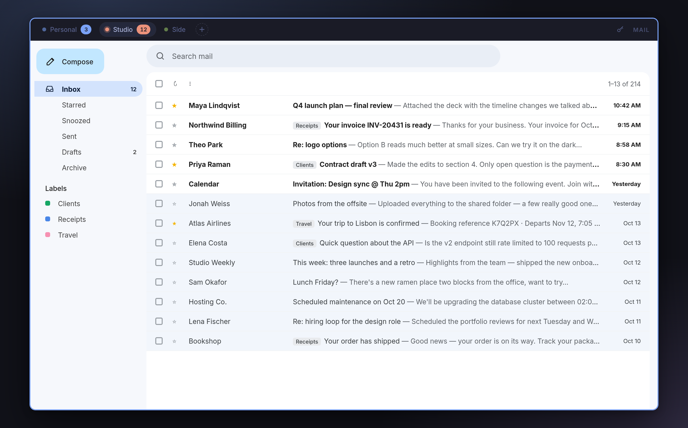
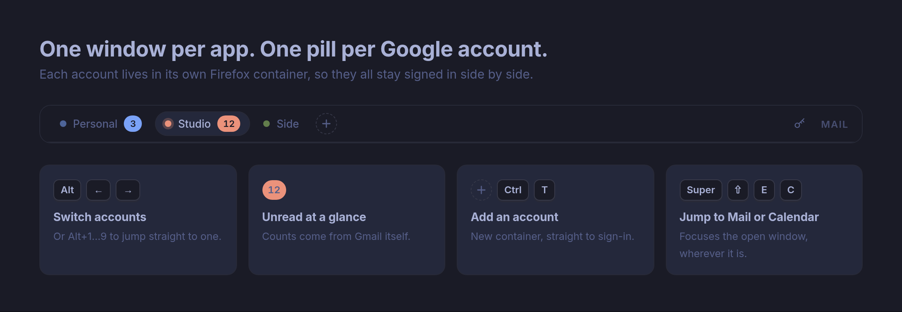
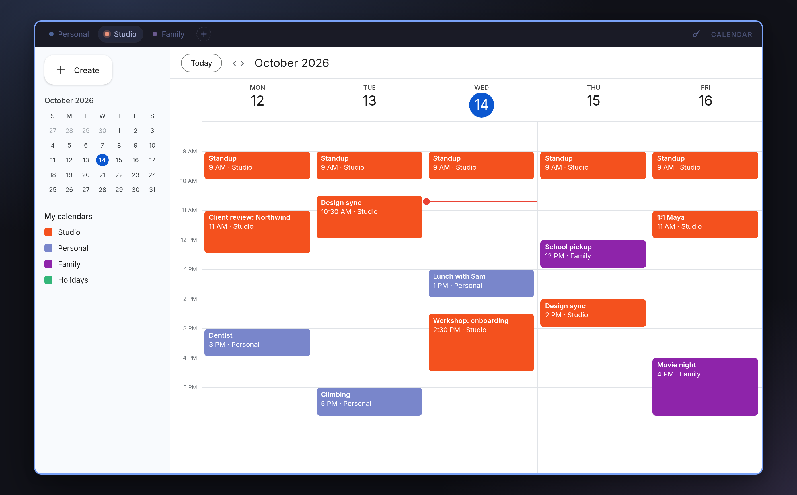
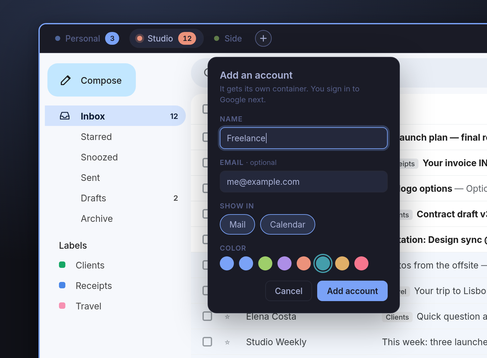
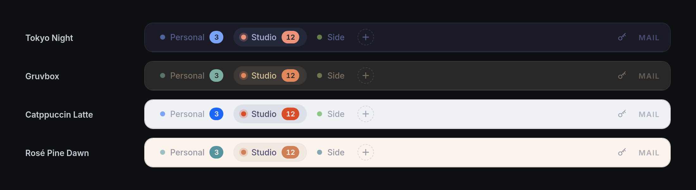

# omarchy-container-gapps

Gmail and Google Calendar as two clean desktop apps on Omarchy, with one
Firefox container per Google account. Each account is a pill in a slim strip
at the top of the window; nothing else of the browser shows.





- **Mail** (Super+Shift+E) and **Calendar** (Super+Shift+C) open on the current
  workspace, or switch to wherever they are already open. Super+Shift+Alt+E starts a new email
  in the selected account.
- **Alt+←/→** steps through accounts; **Alt+1…9** jumps to one.
- Unread counts from Gmail show on each pill.
- Colors follow the current Omarchy theme and update when it changes.
- Links in emails and events open in your default browser. Google links (Docs,
  Sheets, Drive, Meet…), attachments and sign-in pages stay in the app as a tab
  in the same account.'s container.
- Each account signs in once, in its own container, and stays signed in.

<table><tr>
<td></td>
<td></td>
</tr></table>

The pill strip follows whichever Omarchy theme is active:



## Install

```sh
git clone https://github.com/stewartjarod/omarchy-container-gapps ~/Projects/omarchy-container-gapps
cd ~/Projects/omarchy-container-gapps
./install.sh
```

Then list your accounts in `~/.config/omarchy-container-gapps/accounts`:

```
# label     apps       email               color
Personal    mail,cal   you@example.com
Work        mail,cal   you@example.org     orange
Side        mail
```

Or add one without opening the file: click **+** after the pills (or press
Ctrl+T in the app), or run

```sh
omarchy-container-gapps add Work you@example.org orange
```

`apps` is `mail`, `cal` or `mail,cal`. Email and color are optional; the email
pre-fills Google's sign-in page, and the color is a theme color name
(`accent`, `red`, `green`, `yellow`, `blue`, `magenta`, `cyan`, `orange`) or
`#rrggbb`. Edits show up in open windows within a couple of seconds.

### Password manager

The app is its own Firefox profile, so browser extensions are installed
separately. For 1Password:

```sh
omarchy-container-gapps addons
```

opens its add-ons page in the Mail window; click **Add to Firefox**. Extension
buttons sit at the right end of the pill strip.

## How it works

| Piece | Where | What |
| --- | --- | --- |
| Loader | `/usr/lib/firefox/omarchy-container-gapps.cfg` + `defaults/pref/omarchy-container-gapps.js` | Firefox autoconfig. Runs in every Firefox profile, returns at once unless the profile has `gapps/gapps.sys.mjs`. The only part that needs sudo. |
| App module | `firefox/gapps.sys.mjs` | Creates the containers, opens one tab per account, draws the pills, handles the keys, hands links to the default browser, and re-reads the accounts file and the Omarchy theme every 2s. |
| Window style | `firefox/gapps.css` | Hides the browser UI and styles the pill strip. Loaded only into app windows. |
| Profile | `~/.local/share/omarchy-container-gapps/profile` | Created by the launcher, with `user.js` and the module linked from this repo. |
| Launcher | `bin/omarchy-container-gapps` | `mail`, `calendar`, `mail --compose`, `addons`. Focuses an open window or asks Firefox for one. |
| Hyprland | `hypr/omarchy-container-gapps.lua` | Keybindings and an opaque window rule; required from `~/.config/hypr/hyprland.lua`. |

The app runs as its own Firefox process with the window class
`omarchy-container-gapps`, titled `Mail · <account>` or
`Calendar · <account>`. Your main Firefox profile is untouched.

The module uses Firefox internals, so a Firefox update can break it. If the
app opens as a plain Firefox window, set `omarchy-gapps.debug` to `true` in
`about:config` of the app profile and read `gapps.log` in the profile folder.

## Screenshots

The images in `docs/` are mockups with made-up accounts and data, drawn from
`docs/screenshots/mock.html` with the same styles as the app. Regenerate them
with:

```sh
CHROME=/usr/bin/chromium node docs/screenshots/render.cjs
```

## Uninstall

```sh
./uninstall.sh          # keeps your accounts file and sign-ins
./uninstall.sh --purge  # removes them too
```

## Contributing

Commits follow [Conventional Commits](https://www.conventionalcommits.org/);
enable the hook with `git config core.hooksPath .githooks`. Run
`tests/privacy.sh` before pushing.
